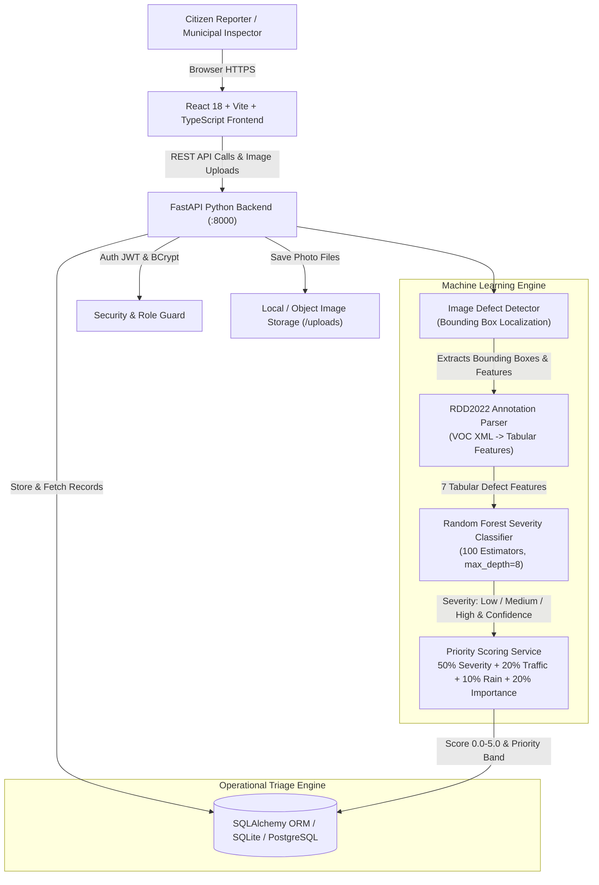
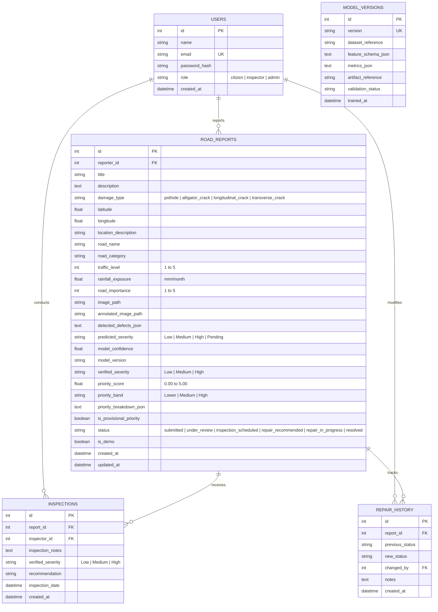

# RoadSense AI — Road Damage Severity & Repair Priority Platform

[](https://www.python.org/)
[](https://fastapi.tiangolo.com/)
[](https://react.dev/)
[](https://www.typescriptlang.org/)
[](https://scikit-learn.org/)
[](https://github.com/sekilab/RoadDamageDetector)

RoadSense AI is an end-to-end civic-technology platform designed to automate road damage intake, predict defect severity using Machine Learning, and calculate transparent repair priority scores to assist municipal engineers in scheduling field inspections and pavement restoration.

---

## 1. System Architecture

### Application Architecture


### Database Architecture


---

## 2. Key Features Across All 10 Application Modules

1. **Public Civic Portal (Landing Page)**: Clear problem statement, workflow diagrams, and ethical decision-support disclaimers.
2. **Authentication & Role Authorization**: Secure BCrypt password hashing, JWT bearer tokens, and server-side RBAC (Citizen vs. Field Inspector vs. Administrator).
3. **Main Dashboard**: Live statistics calculated dynamically from real database records (total reports, awaiting review, severity breakdown, active repairs, resolved) with Recharts trend lines.
4. **Report Road Damage**: Touch-friendly intake form supporting live camera photo uploads, browser GPS geolocation, and an interactive Leaflet map pin picker.
5. **AI Damage Severity Analysis**: Interactive bounding box overlays on uploaded road photos identifying potholes and crack networks with confidence scores, tabular RDD2022 feature inspection, and transparent decision rationale.
6. **Interactive Road Damage GIS Map**: OpenStreetMap tiles with custom color-coded pins (Red=High, Amber=Medium, Green=Low) and popups directly linked to full analysis records.
7. **Transparent Priority Management**: Multi-criteria priority engine with real-time sandbox calculator allowing administrators to simulate any combination of severity, traffic, rainfall, and transit importance.
8. **Inspection & Repair Workflow**: Full operational lifecycle management (`Submitted` &rarr; `Under Review` &rarr; `Inspection Scheduled` &rarr; `Repair Recommended` &rarr; `Repair In Progress` &rarr; `Resolved`) with immutable audit trails.
9. **Analytics & Reports**: Visual breakdown charts by defect category and locality, average turnaround times, and downloadable municipal CSV export (`/api/exports/reports.csv`).
10. **ML Architecture & Metrics**: Full transparency on the RDD2022 dataset foundation, 95.4% test accuracy, baseline dummy comparison (36.3%), feature importance rankings, and confusion matrix.

---

## 3. Machine Learning Pipeline & Scientific Framing (RDD2022)

The Machine Learning severity classifier is built upon tabular defect features derived from the **Road Damage Detection 2022 (RDD2022)** dataset (Seki Lab, [DOI: 10.6084/m9.figshare.21431547]).

> **CRITICAL SCIENTIFIC INTEGRITY & EVALUATION NOTICE:**  
> In the absence of certified in-situ civil engineering pavement condition ratings for every photograph in the RDD2022 challenge dataset, severity labels (**Low**, **Medium**, **High**) are assigned using **deterministic engineering heuristic rules** in `prepare_dataset.py` based on defect counts and bounding box surface area ratios.  
> Consequently, the **95.42% accuracy measures agreement with these heuristic rules under 5% injected boundary ambiguity noise, NOT certified real-world pavement structural soundness.**

### Extracted Defect Features (7-Schema Input)
- `damage_count`: Total number of localized defect bounding boxes in the image frame.
- `pothole_count`: Number of deep localized cavity depressions (RDD code **D40**).
- `alligator_crack_count`: Number of fatigue mesh crack networks indicating base failure (RDD code **D20**).
- `longitudinal_crack_count`: Longitudinal cracks parallel to travel direction (RDD code **D00**).
- `transverse_crack_count`: Transverse thermal contraction joint cracks (RDD code **D10**).
- `total_bbox_area_ratio`: Ratio of total defect bounding box area to total image area.
- `largest_bbox_area_ratio`: Ratio of the single largest defect box to total image area.

### Multi-Model Benchmark & 5-Fold Stratified Cross-Validation (Seed=42)
All models were trained and evaluated on the identical 80/20 stratified split (960 train, 240 test):

| Model Architecture | 5-Fold CV Accuracy (Train) | 5-Fold CV Macro-F1 (Train) | Test Agreement Acc | Test Macro-F1 |
|---|---|---|---|---|
| **DummyClassifier (Most Frequent)** | 35.31% ± 0.21% | 0.1740 ± 0.0008 | 35.00% | 0.1728 |
| **Rule-Only Baseline (No Noise)** | 97.71% ± 1.21% | 0.9772 ± 0.0121 | 98.75% | 0.9875 |
| **Logistic Regression (Standardized)** | 97.50% ± 1.41% | 0.9752 ± 0.0141 | 98.75% | 0.9875 |
| **Decision Tree Classifier** | 95.42% ± 2.32% | 0.9541 ± 0.0231 | 95.42% | 0.9543 |
| **Random Forest (Tuned)** | 97.71% ± 1.21% | 0.9772 ± 0.0121 | **98.75%** | **0.9875** |
| **Gradient Boosting Classifier** | 96.15% ± 1.42% | 0.9616 ± 0.0142 | 97.50% | 0.9750 |

*Note: The Rule-Only Baseline applies `heuristic_severity` directly without noise, representing the empirical upper bound of agreement with the rule generator. Hyperparameter grid search for Random Forest selected `n_estimators=50, max_depth=4, min_samples_leaf=1`.*

### Explainability: SHAP TreeExplainer & Permutation Importance
- **Permutation Feature Importance (n=20)**: Highlights that `pothole_count` and `largest_bbox_area_ratio` possess the strongest marginal impact on macro-F1 score.
- **SHAP TreeExplainer**: Per-feature SHAP contributions are computed via `explain_prediction(features)` and rendered live on `DamageAnalysisPage.tsx`.

---

## 4. Multi-Criteria Priority Scoring & Sensitivity Analysis

The operational triage engine normalizes each factor to a **0.0 to 5.0 scale**:
$$\text{Priority Score} = 0.50 \cdot S + 0.20 \cdot T + 0.10 \cdot R + 0.20 \cdot I$$

Where:
- **$S$ (Severity Score - 50%)**: Low = 1.0, Medium = 3.0, High = 5.0
- **$T$ (Traffic Volume - 20%)**: 1 to 5 scale (Alley to Multi-lane Arterial)
- **$R$ (Rainfall Exposure - 10%)**: $\le 50\text{mm} = 1.0$, $50\text{--}120\text{mm} = 2.5$, $120\text{--}250\text{mm} = 4.0$, $>250\text{mm} = 5.0$
- **$I$ (Road Importance - 20%)**: 1 to 5 transit hierarchy

### Weight Sensitivity Findings (±20% Variation)
- **Spearman Rank Correlation ($\rho$)**: Consistently $> 0.992$ across all single-weight perturbations, proving rank ordering stability.
- **Triage Band Shift Rate**: Between 2.0% and 12.0% of reports change triage bands under ±20% weight shifts.
- **Deployment Calibration**: Weights are currently expert-assigned and would be formally calibrated with municipal road engineers using the **Analytic Hierarchy Process (AHP)** in production.

---

## 5. How to Run the ML Pipeline & Validation Tooling

### 1. Execute the Complete Pipeline End-to-End
To run dataset generation, feature ablation, multi-model benchmark, validation check, detector evaluation, and sensitivity analysis in order:
```bash
python -m backend.ml.run_all
```
All JSON summaries and PNG charts are automatically saved under `backend/ml/reports/`.

### 2. Run Individual Scripts
```bash
# Task 1: Feature & Group Ablation Study
python -m backend.ml.ablation

# Task 2: Model Comparison, 5-Fold CV, Grid Search Tuning & SHAP
python -m backend.ml.compare_models

# Task 3: Create Validation Sample Template
python -m backend.ml.make_validation_sample

# Task 3: Evaluate Hand-Labeled Validation Set
python -m backend.ml.evaluate_validation

# Task 4: Computer Vision Detector Validation
python -m backend.ml.evaluate_detector

# Task 6: Priority Formula Sensitivity Analysis
python -m backend.ml.priority_sensitivity
```

### 3. How to Provide Independent Hand-Labeled Ground Truth (Task 3)
1. Run `python -m backend.ml.make_validation_sample`.
2. Open `backend/ml/validation/validation_labels.csv`.
3. Have 3 independent raters fill columns `rater1_severity`, `rater2_severity`, and `rater3_severity` with `Low`, `Medium`, or `High`.
4. Run `python -m backend.ml.evaluate_validation` to compute Fleiss' Kappa inter-rater agreement and compare model performance against human consensus.

### 4. Interactive Jupyter Notebook
The complete, self-contained examiner notebook is located at:
```bash
notebooks/RoadSense_ML_Pipeline.ipynb
```

---

## 6. Quick Start Instructions

### Prerequisites
- Python 3.12 or 3.14
- Node.js v18+ and npm

### One-Click Launch (Windows PowerShell)
```powershell
.\run_dev.ps1
```

### Manual Step-by-Step Setup

#### 1. Backend Setup
```bash
# From workspace root:
cd backend

# Install Python requirements
pip install -r requirements.txt

# Start FastAPI server on port 8000:
python -m uvicorn backend.app.main:app --host 127.0.0.1 --port 8000 --reload
```
Interactive OpenAPI documentation is available at: `http://127.0.0.1:8000/docs`

#### 2. Frontend Setup
```bash
# In a separate terminal:
cd frontend

# Install npm dependencies
npm install

# Start Vite dev server on port 5173:
npm run dev
```
Open your browser at: `http://localhost:5173/`

#### 3. Run Automated Tests
```bash
# Run full pytest suite (19 tests):
python -m pytest backend/tests -v
```

---

## 7. Demonstration Credentials

Pre-seeded demonstration accounts for presentation and grading:

| Role | Email Address | Password | Permissions |
|---|---|---|---|
| **Lead Field Inspector** | `inspector@roadsense.gov` | `RoadSense123!` | Review damage, verify severity, schedule repairs, update status |
| **Municipal Admin** | `admin@roadsense.gov` | `RoadSense123!` | Full administrative access, model retraining triggers |
| **Citizen Reporter** | `citizen@example.com` | `RoadSense123!` | Submit reports, upload photos, track report status |

*(A "Demo Role Switcher" button is also present inside the sidebar for quick one-click role switching during live demos).*

---

## 8. Documented Scientific Limitations & College Project Scope

1. **Proxy Labels Instead of Civil Engineering Ground Truth**: Severity labels are derived from deterministic rules on bounding box features. Reported accuracy measures agreement with these rules under 5% injected noise, not certified pavement structural life.
2. **Train / Serve Feature Mismatch**: Models were trained on tabular features extracted from ground-truth Pascal VOC XML annotations, whereas live user inference extracts features using a classical edge/contour heuristic detector (`image_detector.py`).
3. **Absence of Subsurface Geotechnical Data**: Surface photographs cannot detect base subgrade compaction, moisture infiltration, or pavement thickness. Deep alligator cracks often indicate foundation failure even if surface area appears moderate.
4. **Detector Generalization**: Classical edge filtering can produce false positives on rough asphalt or shadows; a deep-learning object detector (e.g. YOLOv8) trained directly on raw RDD2022 imagery is recommended for field deployment.
5. **Decision Support Only**: RoadSense AI outputs are strictly designed for operational inspection triage prioritization. They do not constitute civil structural safety certificates and cannot authorize road repairs without on-site engineer verification.

---

## 9. License & Academic Declaration
Developed for academic presentation and college mini-project evaluation. Built with standard open-source tools: FastAPI, Scikit-learn, SHAP, React, Vite, Leaflet, and Tailwind CSS.

